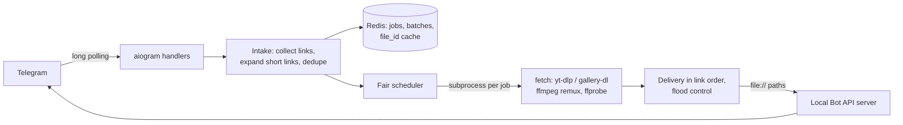

# Grabby

[@grabby_soc_bot](https://t.me/grabby_soc_bot) is a Telegram bot that downloads videos and photos from TikTok, Instagram, YouTube and hundreds of other sites. Send it one link or a hundred: it queues them, shows progress in a single status message and sends everything back in the original order, in the best quality the site offers.

<!-- screenshots -->

## What it does

Sources:

- TikTok videos without the watermark, and photo slideshows as an album followed by the soundtrack.
- Instagram Reels, posts and carousels. A carousel with both photos and videos comes back as one album. Stories and private posts work once you add a cookies file.
- YouTube and Shorts, X, Facebook, Pinterest, Reddit, VK, Threads, Twitch clips, Vimeo, plus whatever else yt-dlp and gallery-dl can open.

Batches can be several links in one message, a stack of forwarded posts (links in the text, captions and buttons all count) or a `.txt` file with a list. Duplicates are dropped and results arrive in the order the links were sent.

With the bundled local Telegram Bot API server files go up to 2 GB; the public api.telegram.org caps bots at 50 MB. Either way, for anything over the limit the bot offers a 720p version or the same video cut into parts.

The best video and audio streams are merged without re-encoding. When two formats have the same resolution, H.264/AAC is preferred because every Telegram client plays it inline. Videos are sent with `supports_streaming`, real dimensions, duration and a thumbnail, and each one has a "Send as file" button for the untouched original.

Errors are reported in plain words ("the post was deleted", "the account is private", "the site only shows it after logging in") together with a "Retry failed" button. `/cancel` stops the whole queue.

When someone sends a link the bot has already handled, it re-sends the Telegram `file_id` instead of downloading again.

`/settings` switches quality (max or data saver), video or file, the caption, the footer line and the language (Russian or English). Admins get `/stats`, an invite-only mode, bans and manual extractor updates.

## How it works



Every download runs in its own `python -m grabby.fetch` process. A stuck or cancelled job can be killed together with its ffmpeg children, yt-dlp's memory never piles up in the bot, and a freshly installed extractor version is picked up by the next job without a restart. The bot talks to the subprocess with a small JSON protocol (`grabby/fetch/protocol.py`).

The scheduler gives users turns: one person's 100 links don't block someone else's single link. There are caps per user, per site (so TikTok and Instagram don't ban the server's IP) and overall, plus a disk budget: new downloads wait while the work directory is full or free disk space is low. Jobs and batches live in Redis, so after a restart unfinished batches pick up where they stopped.

Delivery runs one loop per batch and sends results strictly in link order, even when later links finish first. Bot API calls go through a wrapper that waits out `retry_after` on HTTP 429 and rebuilds media groups on retry, so no file is lost to flood control.

Sites change their APIs all the time, so yt-dlp and gallery-dl update themselves. A new version is installed next to the current one and only switched on after it downloads a set of probe links at least as well as the old one; otherwise it is thrown away. `/rollback` goes back by hand.

### Things that needed custom code

| Problem | Solution |
|---|---|
| yt-dlp doesn't support TikTok slideshows, gallery-dl got 403 | Reuse yt-dlp's page fetching (browser impersonation, JS challenge) and read the slideshow from the page data |
| Instagram photo posts have no "formats" in yt-dlp | The full-size image is in the thumbnail list; carousels are extracted first and only video entries are downloaded |
| Threads has no extractor anywhere | Parse the post JSON embedded in the server-rendered page |
| Short links behave differently per site | TikTok redirects only for link-preview user agents, Instagram `/share/` needs browser fetch headers, pin.it has its own API, t.co answers browsers with HTML |
| Forwarding 100 posts arrives as 100 concurrent updates | Messages are buffered per user for a moment and sorted by message id before they join the batch |

### Security

The bot is public, so every link is untrusted input. Links to private, loopback and link-local addresses are refused, and the download subprocess checks the actual IP of every outgoing connection, which also covers redirects and media URLs found inside pages. ffmpeg only opens local files with plain media demuxers, so a playlist disguised as a video can't make it read files from the server. The subprocess gets no bot token or other secrets.

## Stack

- Python 3.13, aiogram 3, aiohttp
- yt-dlp (with curl_cffi impersonation and Deno for YouTube), gallery-dl
- ffmpeg / ffprobe
- Redis 8 with AOF
- telegram-bot-api server in `--local` mode
- pytest, Ruff, mypy (strict), GitHub Actions, Docker Compose

## Running it

You need a bot token from [@BotFather](https://t.me/BotFather). For 2 GB uploads you also need `api_id` / `api_hash` from [my.telegram.org](https://my.telegram.org) for the local Bot API server.

```bash
cp .env.example .env    # fill BOT_TOKEN and ADMIN_IDS
docker compose up -d --build
docker compose logs -f bot
```

That starts the bot and Redis against api.telegram.org. With `TELEGRAM_API_ID`, `TELEGRAM_API_HASH`, `COMPOSE_PROFILES=local-api` and `BOT_API_URL=http://bot-api:8081` in `.env`, the same command also starts the local Bot API server. Every container has CPU and memory limits; the whole stack fits in about 1 GB of RAM.

For development without Docker:

```bash
uv sync
docker run -d -p 6379:6379 redis:8-alpine
uv run python -m grabby          # BOT_API_URL empty: talks to api.telegram.org, 50 MB limit
uv run pytest
uv run ruff check . && uv run mypy
```

Settings are environment variables, all listed in [`.env.example`](.env.example). Deployment, cookies, proxies and operations are in [docs/deploy.md](docs/deploy.md).

## Project layout

```
src/grabby/
  domain/     links, platforms, errors, media rules, captions, job models (no I/O)
  fetch/      the download subprocess: yt-dlp, gallery-dl, TikTok slideshows, Threads, ffmpeg
  services/   scheduler, pipeline, short-link resolver, work dir budget, extractor updater
  infra/      Redis store
  bot/        aiogram handlers, intake, delivery, keyboards, RU/EN texts
tests/        140 tests: link parsing, scheduling, ordered delivery, restart recovery, ffmpeg
```

## License

MIT
